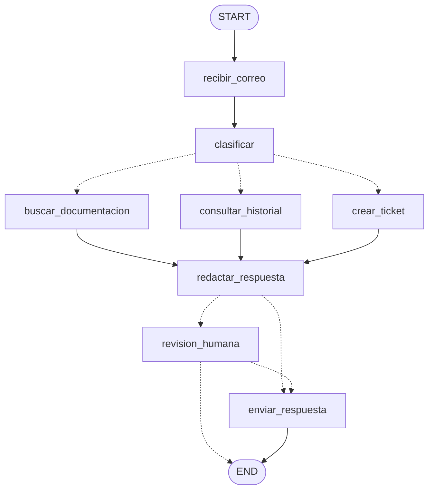

# Agente de soporte por correo (LangGraph + LangSmith)

Atiende los correos de soporte de **Contaflux**, una empresa ficticia de facturación electrónica:

1. **Clasifica** el correo (intención y urgencia) con salida estructurada.
2. **Junta contexto en paralelo:**
   - busca en la base de conocimiento (RAG);
   - consulta el historial del cliente;
   - crea un ticket si es un bug o algo crítico.
3. **Redacta** una respuesta usando solo esa documentación.
4. **Decide con código** si una persona debe revisarla. Si sí, **se pausa** con `interrupt()` y espera a que alguien apruebe, edite o rechace.
5. **Envía** la respuesta (simulado).

Todo queda trazado en LangSmith, y hay evals con evaluadores de código y un LLM como juez.

## El grafo



Las líneas punteadas son rutas condicionales.

| Concepto | Dónde está |
|---|---|
| Estado compartido y reductor (`operator.add`) | `src/soporte/state.py`, clave `pasos` |
| Salida estructurada (Pydantic) | `llm.py`, `clasificar_con_llm` |
| RAG: fragmentar, hacer embeddings y buscar | `kb.py` |
| Arista condicional con varias ramas en paralelo | `nodes.rutas_tras_clasificar` + `graph.py` |
| `Command` (actualizar estado y enrutar a la vez) | `nodes.redactar_respuesta`, `nodes.revision_humana` |
| Human in the loop con `interrupt()` | `nodes.revision_humana` |
| Checkpointer y `thread_id` | `scripts/demo.py`, `tests/test_grafo.py` |
| Errores guardados en el estado, sin tumbar el grafo | `nodes.buscar_documentacion` |
| Evals: código + LLM juez estrecho y binario | `evals/run_evals.py` |

## Instalación

```bash
python -m venv .venv
source .venv/bin/activate          # En Windows: .venv\Scripts\activate
pip install -e ".[dev]"
cp .env.example .env               # llena OPENAI_API_KEY y LANGSMITH_API_KEY
```

## Cómo usarlo

```bash
pytest                             # 12 tests, sin llaves y sin gastar tokens (LLM falso)
python scripts/demo.py             # procesa los 8 correos de ejemplo y te pide aprobar en consola
python scripts/demo.py 1           # solo el correo #1 (cobro duplicado, pide revisión)
langgraph dev --allow-blocking     # abre LangGraph Studio con el grafo
python evals/run_evals.py          # crea el dataset en LangSmith y corre el experimento
```

### En LangGraph Studio

1. Corre `langgraph dev --allow-blocking` y abre el enlace de Studio que aparece en la terminal.
   (`--allow-blocking` evita que el servidor de desarrollo bloquee el tracer de LangSmith, que hace
   llamadas síncronas al iniciar; sin él, las corridas de Studio no aparecen en LangSmith.)
2. En *Input* llena `remitente`, `asunto` y `cuerpo` (el grafo declara ese esquema de entrada), por ejemplo:
   ```json
   {"remitente": "laura.gomez@logisticaandina.com", "asunto": "Cobro doble", "cuerpo": "Me cobraron dos veces la suscripción este mes."}
   ```
3. Mira cómo corren en paralelo las ramas de contexto y cómo el grafo se detiene en `revision_humana`.
4. Reanuda con `{"accion": "aprobar"}`, `{"accion": "editar", "texto": "..."}` o `{"accion": "rechazar"}`.
5. Abre la traza en LangSmith para ver el prompt, los fragmentos recuperados y los tokens de cada paso.

## Costo

Por defecto se usa `gpt-4.1-mini` y `text-embedding-3-small`; los dos se cambian en `.env`. Con los precios publicados por OpenAI (revísalos antes de usar), un correo cuesta del orden de **un décimo de centavo de dólar**: dos llamadas al LLM de menos de 2.000 tokens. Una corrida completa de evals (8 correos más el juez) cuesta unos **2 centavos**. Configura un límite de gasto en el panel de OpenAI.

## Decisiones de diseño

- **Workflow, no agente libre.** El camino se conoce de antemano, así que un grafo explícito es más predecible y fácil de probar que un loop ReAct que decide solo.
- **El LLM clasifica y el código decide.** La regla de quién revisa está en `necesita_revision`, no en el prompt.
- **`interrupt()` al inicio del nodo.** Al reanudar, el nodo se ejecuta otra vez desde el principio; nada costoso o con efectos va antes de la pausa.
- **Estado con tipos simples.** La clasificación se guarda como dict para que serialice bien en el checkpointer y se lea fácil en Studio.
- **LLM aislado en `llm.py`.** Los tests lo reemplazan con `monkeypatch`, así que corren sin red y sin costo.
- **Un fragmento por sección del markdown.** Cada sección responde una sola pregunta, y la fuente (`archivo#sección`) se puede citar.

## Cómo se construyó

En cuatro PRs apilados; cada uno parte del anterior y deja los tests en verde:

1. `pr/01-flujo-basico`: flujo lineal y salida estructurada.
2. `pr/02-rag-y-contexto`: RAG, historial y tickets en paralelo.
3. `pr/03-revision-humana`: `interrupt()` y `Command`.
4. `pr/04-evals-y-demo`: evals en LangSmith, la demo y esta documentación.
5. `pr/05-ajustes-studio-y-tests`: correcciones tras probarlo en Windows (numpy faltante,
   esquema de entrada para Studio, prompt que usa los datos concretos de la documentación).

## Siguientes pasos

- Checkpointer persistente (`SqliteSaver` o `PostgresSaver`) en lugar de memoria.
- Reintento de la búsqueda cuando falla, con una arista de vuelta a `buscar_documentacion`.
- Evals online y automatizaciones en LangSmith sobre tráfico real.
