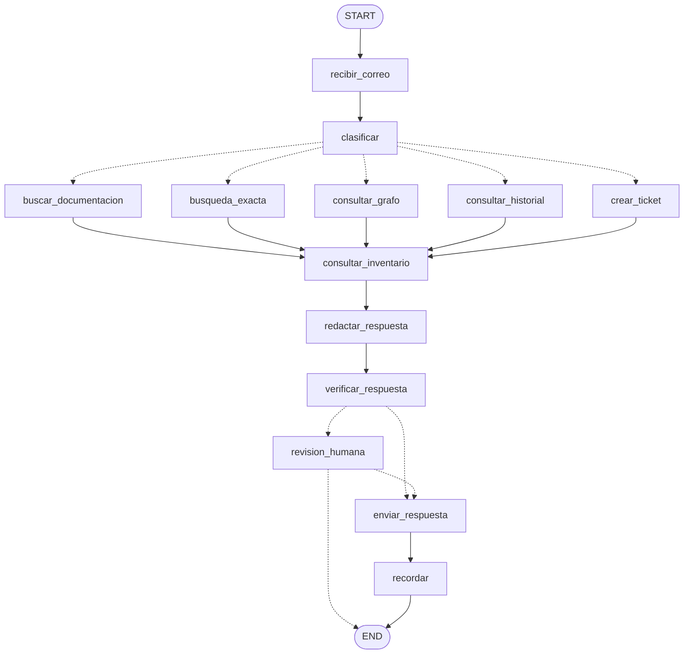

# Agente de soporte por correo (LangGraph + LangSmith)

> Corre todo en tu computador con un solo comando: `python -m soporte.api` abre el dashboard en
> http://localhost:8000. Solo necesitas una llave de OpenAI (y una de LangSmith para ver las trazas).

Atiende los correos de clientes de **Andina Automatización**, un distribuidor ficticio de componentes de
automatización industrial (sensores, válvulas neumáticas, fuentes de poder), con un catálogo de números de pieza:

1. **Clasifica** el correo (intención y urgencia) con salida estructurada.
2. **Junta contexto en paralelo:**
   - **búsqueda vectorial** (RAG) en el catálogo;
   - **búsqueda exacta**: cada número de pieza del correo se busca literalmente en el catálogo (como `grep`);
   - **grafo de equivalencias**: sustitutos de piezas de otras marcas o descontinuadas, accesorios y fuentes;
   - consulta el historial del cliente;
   - abre un caso si es una garantía o la línea del cliente está parada.
3. **Consulta precio y stock en SQL** de las piezas del caso: esos datos no están en el RAG.
4. **Redacta** una respuesta usando solo lo que reunieron esos pasos.
5. **Verifica** el borrador en dos capas: un piso literal sin LLM (cada número de pieza y dato con unidad
   tiene que existir en el catálogo o el inventario) y un **verificador agente**, un segundo LLM que elige qué más comprobar
   y busca en el catálogo con una herramienta determinista.
6. **Decide con código** si una persona debe revisarla: por la verificación o por reglas de negocio. Si sí,
   **se pausa** con `interrupt()` y espera a que alguien apruebe, edite o rechace, viendo el motivo.
7. **Envía** la respuesta (simulado) y **recuerda** qué piezas pidió el cliente, para el próximo correo.

Todo queda trazado en LangSmith, y hay evals con evaluadores de código y un LLM como juez.

## La idea: no confiar en la similitud para lo que tiene que ser exacto

Un RAG vectorial encuentra textos *parecidos*. Para un catálogo eso es un riesgo: `SI-M12-04P` y
`SI-M12-06P` se parecen mucho como vectores, pero la segunda pieza no existe. Un modelo que recibe la ficha
de la primera puede contestar sobre la segunda con total seguridad.

Por eso la búsqueda literal (`conocimiento/busqueda.py` y `conocimiento/verificacion.py`, en la línea de "grep is all you need") aparece en
dos momentos con trabajos distintos: uno **previene** y el otro **detecta**.

| Paso | Cuándo | Qué hace | Para qué |
|---|---|---|---|
| Búsqueda exacta | En paralelo con la vectorial, antes de redactar | Busca literalmente los números de pieza del correo | **Previene:** el modelo recibe la ficha correcta aunque la vectorial no la traiga, y se sabe si el cliente pide una pieza que no existe |
| Piso literal | Después de redactar | Extrae números de pieza y datos con unidad del borrador y los busca tal cual | **Detecta** referencias, precios o medidas inventadas |
| Verificador agente | Después de redactar | Un LLM elige qué afirmaciones comprobar y las busca con la herramienta `buscar_en_catalogo` | **Detecta** lo que una regex no ve: un dato real atribuido a otra pieza, compatibilidades, políticas |

### Por qué hay un verificador agente

El piso literal tiene un punto ciego: comprueba que cada término exista, no a qué pieza pertenece.
"El SI-M12-04P detecta a 8 mm" pasa el piso, porque `SI-M12-04P` y `8 mm` existen en el catálogo, pero
8 mm es del SI-M18-08P. El verificador agente lee la ficha que devuelve su búsqueda y marca la afirmación
como contradicha.

Cómo se reparte el trabajo:

- **El LLM decide qué buscar; la herramienta decide qué hay.** `buscar_en_catalogo` es la misma búsqueda
  literal, sin LLM. El modelo no puede "encontrar" algo que no está.
- **El piso no se negocia.** El verificador puede agregar comprobaciones, pero no quitar las del piso.
- **No se le cree sin evidencia.** Una afirmación solo cuenta como respaldada si cita una sección que la
  herramienta de verdad devolvió en esa verificación; si no, el código la baja a "sin respaldo".
- **El código decide.** Cualquier contradicción, afirmación sin respaldo o falla del verificador (timeout,
  se pasó del tope de llamadas, no entregó veredicto) manda la respuesta a revisión humana. Lo peor que puede
  pasar es revisar de más, no dejar pasar un invento.

### Cómo está hecho: `create_agent` y middleware

El verificador usa `create_agent` de LangChain v1, que trae resuelto el loop de herramientas. Las reglas se
le agregan como **middleware**: código que se engancha en ese loop sin tocar el agente.

| Regla | Middleware | Tipo de gancho |
|---|---|---|
| Máximo 5 llamadas al modelo; si se pasa, error y revisión humana | `ModelCallLimitMiddleware` | De punto (`before_model`) |
| Máximo 6 búsquedas; las de más no corren y el modelo entrega con lo que tiene | `ToolCallLimitMiddleware` | De punto |
| No aceptar el veredicto si llega en la misma vuelta en que pide búsquedas | `exigir_lectura_antes_del_veredicto` (propio) | De envoltura (`wrap_model_call`) |

Otras piezas de LangChain que usa:

- **`ToolStrategy(EntregarVeredicto)`:** el veredicto es una herramienta más con esquema Pydantic. `create_agent`
  obliga a llamar alguna herramienta en cada vuelta (`tool_choice="any"`), así que el modelo nunca responde en
  texto libre, y si el veredicto llega mal formado le devuelve el error para que lo corrija.
- **`@tool(response_format="content_and_artifact")`:** la herramienta devuelve el texto que lee el modelo y,
  aparte, las fuentes encontradas. Las fuentes no pasan por el modelo; el código las usa para validar lo que cite.

La regla de negocio (enviar o revisar) **no** es un middleware: queda en el nodo `verificar_respuesta`, fuera
del agente, porque decidirla no le toca al modelo.

En el piso literal, cada dato del borrador queda en uno de tres estados:

- **respaldado:** está en lo que el modelo vio;
- **fuera de contexto:** existe en el catálogo, pero el modelo no lo vio (se informa, no se bloquea);
- **no encontrado:** no aparece en ninguna parte del catálogo. Bloquea el envío y lo manda a revisión humana con el motivo.

La comparación es literal pero cuidadosa: `SI-M12-04P` no coincide dentro de `SI-M12-04P-L`, `8 bar` no coincide
dentro de `18 bar`, y `$54`, `54 USD` y `USD 54` cuentan como el mismo precio. Sus límites, a propósito: no
entiende sinónimos ni paráfrasis (solo comprueba lo que se puede comprobar literalmente) y no valida cálculos;
por eso el prompt pide no calcular totales.

## Precios y stock: SQL, no RAG

El precio y el stock cambian seguido. Si vivieran en los fragmentos que se vectorizan, el agente podría leer
un dato viejo y decir "hay 2 en stock" cuando hay 0. Por eso cada dato tiene **una sola fuente de verdad**:

| Dato | Fuente de verdad | Cómo llega | Cada cuánto |
|---|---|---|---|
| Especificaciones, políticas, equivalencias | `data/kb/*.md` → RAG y búsqueda literal | Texto que se vectoriza | Rara vez cambia |
| Precio por pieza | Tabla `productos` en SQLite | `data/inventario/precios.csv` (la lista del cliente) | Una vez al mes |
| Stock por bodega | Tabla `stock` en SQLite | `data/inventario/stock-AAAA-MM-DD.pdf` (el PDF diario del cliente) | Cada día |

Cómo se carga (`datos/inventario.py`):

- **El PDF se lee como tabla**, con `pdfplumber`, no como texto partido en fragmentos: así ninguna fila se corta
  ni queda sin encabezado. La fecha del inventario sale del título del PDF.
- **Validar antes de cargar:** si falta una columna necesaria o un valor no tiene el tipo esperado, la carga
  falla con un mensaje claro y la base no se toca. Una columna extra no rompe nada.
- **Todo o nada:** el stock se borra y se vuelve a cargar dentro de una transacción. Si una fila trae una pieza
  desconocida (llave foránea) o unidades negativas (`CHECK`), se deshace todo y queda el stock de ayer.
- **Consultas con parámetros:** los códigos llegan del correo del cliente, así que van como `?` y nunca pegados
  al SQL. Un correo con `x'; DROP TABLE stock; --` se busca como texto y no encuentra nada.
- **Con fecha:** el agente dice "según el inventario del 2026-11-18" en vez de prometer.

La base (`data/inventario.sqlite`) se crea sola la primera vez. Para recargarla, por ejemplo cuando llega un PDF
nuevo: `python -m soporte.datos.inventario`. En producción eso lo haría un proceso programado o la llegada
del correo del cliente.

## El grafo de equivalencias (un grafo de conocimiento)

Hay preguntas cuya respuesta está repartida en varios documentos, y la búsqueda vectorial no las resuelve bien:

```
"Tengo un Proxima PX-12-4P, ¿qué fuente necesito para su reemplazo?"

PX-12-4P --sustituible_por--> SI-M12-04P <--puede_alimentar-- FP-24-5
```

`conocimiento/grafo_de_equivalencias.py` guarda las piezas como nodos y sus relaciones como aristas, en un JSON
(`data/grafo/grafo.json`). No confundir con el grafo de LangGraph (`agente/flujo.py`), que es el flujo de control.

| Relación | Origen | Cómo se obtiene |
|---|---|---|
| `reemplazado_por` | Documento | `data/grafo/relaciones.json`: una pieza descontinuada y su reemplazo, según el catálogo |
| `requiere` | Documento | Accesorios obligatorios, como el reflector RF-50 del SF-R2M-P |
| `sustituible_por` | **Regla** | Calculada desde `data/grafo/especificaciones.csv`: misma familia, tamaño, distancia, salida y conexión, y un rango de alimentación que cubre el original |
| `puede_alimentar` | **Regla** | La tensión de salida de la fuente cae dentro del rango del sensor |

Las equivalencias **las calcula una regla, no un LLM**: o las medidas coinciden, o no hay arista. La regla es
dirigida (un sensor de 10 a 30 VDC sustituye a uno de 12 a 24 VDC, pero no al revés) y solo ofrece piezas activas
que el distribuidor vende. Si ninguna coincide, el grafo lo dice y el agente no inventa un sustituto.

El nodo `consultar_grafo` recorre el grafo desde cada pieza del correo, acotado: hasta 2 saltos de sustitución y,
para cada pieza propia en ese camino, sus accesorios y fuentes. Las piezas que encuentra pasan al inventario, así
que el agente puede dar el precio y el stock del sustituto. Un código de otra marca que está en el grafo ya no se
reporta como "pieza inexistente".

**Por qué un JSON y no Neo4j:** son 16 piezas y 26 relaciones; un JSON se lee, se versiona en git y corre sin
servicios extra. Si creciera a miles de piezas, el siguiente paso sería Neo4j, y la consulta del ejemplo sería:

```cypher
MATCH (p:Pieza {codigo: 'PX-12-4P'})-[:SUSTITUIBLE_POR]->(s)<-[:PUEDE_ALIMENTAR]-(f)
RETURN s.codigo, f.codigo
```

Para regenerar el JSON después de editar las especificaciones o las relaciones:
`python -m soporte.conocimiento.grafo_de_equivalencias`. Un test falla si el JSON quedó desactualizado.

## Memoria de corto y largo plazo

| | Corto plazo | Largo plazo |
|---|---|---|
| Qué guarda | El estado de un hilo: un correo y todo lo que pasó con él | Lo que se sabe de cada cliente, entre correos |
| Dónde | Checkpointer: `data/checkpoints.sqlite`, por `thread_id` | Store: `data/memoria.sqlite`, por namespace `("clientes", id)` |
| Para qué | Pausar en revisión humana y reanudar, incluso tras reiniciar | Que el agente sepa qué pidió antes el cliente |
| Código | `api/persistencia.abrir_checkpointer` | `soporte/memoria.py`, nodos `consultar_historial` y `recordar` |

Un correo nuevo es un hilo nuevo, así que su memoria de corto plazo empieza vacía; lo que debe sobrevivir va al
Store. Qué se recuerda (memoria **semántica**, hechos sobre el cliente):

- **Piezas consultadas**, con cuántas veces.
- **Preferencias**, como "suele pedir sensores con salida PNP". Un solo correo no dice "siempre": la preferencia
  aparece solo cuando varias consultas coinciden, y la concluye el código desde las especificaciones, no el LLM.

Cuándo se escribe: en el nodo `recordar`, **después de enviar** (directo o aprobado). Una respuesta rechazada
termina antes y no deja recuerdos: no se guarda lo que nadie confirmó. Como corre después de enviar, no retrasa
la respuesta; en producción podría ser un proceso aparte, en segundo plano.

El id del cliente es el dominio de su correo con `_` en vez de puntos (`empacadoraelvalle_com`): los namespaces
del Store no aceptan puntos, y así la llave no guarda el correo de una persona. LangSmith no es memoria: ahí ves las
trazas tú, pero el agente no las lee.

## El grafo



Las líneas punteadas son rutas condicionales.

| Concepto | Dónde está |
|---|---|
| Estado compartido y reductor (`operator.add`) | `agente/estado.py`, clave `pasos` |
| Salida estructurada (Pydantic) | `agente/llm.py`, `clasificar_con_llm` |
| RAG: fragmentar, hacer embeddings y buscar | `conocimiento/rag.py` |
| Búsqueda exacta (el "grep") | `conocimiento/busqueda.py`, nodo `busqueda_exacta` |
| Grafo de conocimiento: aristas calculadas por regla, recorrido acotado | `conocimiento/grafo_de_equivalencias.py`, nodo `consultar_grafo` |
| SQL: tablas con reglas, transacciones, consultas con parámetros | `datos/inventario.py`, `tests/test_inventario.py` |
| Leer una tabla de un PDF | `datos/inventario.leer_stock_pdf` |
| Verificación: piso literal y reglas que juzgan al verificador | `conocimiento/verificacion.py`, nodo `verificar_respuesta` |
| Agente con `create_agent` y middleware (límites, `wrap_model_call` propio) | `agente/verificador.py`, `tests/test_verificador_agente.py` |
| Arista condicional con varias ramas en paralelo | `nodos.rutas_tras_clasificar` + `agente/flujo.py` |
| `Command` (actualizar estado y enrutar a la vez) | `nodos.verificar_respuesta`, `nodos.revision_humana` |
| Human in the loop con `interrupt()` | `nodos.revision_humana` |
| Memoria de corto plazo: checkpointer (SQLite) y `thread_id` | `api/persistencia.py`, `tests/test_api.py` |
| Memoria de largo plazo: Store, namespaces, `Runtime` en un nodo | `soporte/memoria.py`, `nodos.recordar`, `tests/test_memoria.py` |
| Errores guardados en el estado, sin tumbar el grafo | `nodos.buscar_documentacion` |
| Evals: código + LLM juez estrecho y binario | `evals/run_evals.py` |

## Mapa del código

```
src/soporte/
├── config.py              modelos y rutas, desde variables de entorno
├── servicios.py           sistemas externos simulados: CRM, tickets, envío de correo
├── memoria.py             memoria de largo plazo por cliente (Store de LangGraph)
├── agente/                el agente: qué pasos da y en qué orden
│   ├── estado.py          el estado compartido (el contrato entre nodos) y los esquemas Pydantic
│   ├── flujo.py           el grafo de LangGraph: nodos y aristas (flujo de control)
│   ├── nodos.py           lo que hace cada paso
│   ├── prompts.py         los prompts
│   ├── llm.py             clasificar y redactar: las llamadas directas al modelo
│   └── verificador.py     el verificador agente: un LLM con una herramienta de búsqueda
├── conocimiento/          de dónde saca el agente lo que sabe
│   ├── rag.py             búsqueda vectorial sobre data/kb
│   ├── busqueda.py        búsqueda literal y búsqueda exacta de códigos
│   ├── grafo_de_equivalencias.py   el grafo de conocimiento: sustitutos, accesorios, fuentes
│   ├── fuentes.py         las fuentes de verdad para verificar: catálogo + inventario + grafo
│   └── verificacion.py    piso literal y reglas que juzgan al verificador
├── datos/                 datos estructurados del negocio
│   └── inventario.py      precios y stock en SQLite, cargados desde CSV y PDF
├── api/                   FastAPI: transmite el grafo como eventos al dashboard
└── web/                   el dashboard (HTML, CSS y JavaScript sin compilar)
```

Regla de dependencias: `agente/` usa a `conocimiento/`, nunca al revés (salvo los tipos
de `agente/estado.py`). Así lo que sabe el agente se puede probar sin el agente.

## Instalación

```bash
python -m venv .venv
source .venv/bin/activate          # En Windows: .venv\Scripts\activate
pip install -e ".[dev]"
cp .env.example .env               # llena OPENAI_API_KEY y LANGSMITH_API_KEY
```

## Cómo usarlo

```bash
python -m soporte.api              # dashboard en http://localhost:8000 y API en /docs (abre el navegador)
pytest                             # tests del backend, sin llaves y sin gastar tokens (LLM falso)
node --test tests/js/logica.test.mjs   # opcional, si tienes Node: tests de la lógica del dashboard
python scripts/demo.py             # procesa los 9 correos de ejemplo y te pide aprobar en consola
python scripts/demo.py 4           # solo el correo #4 (línea parada, pide revisión)
langgraph dev --allow-blocking     # abre LangGraph Studio con el grafo
python evals/run_evals.py          # crea el dataset en LangSmith y corre el experimento
```

### En LangGraph Studio

1. Corre `langgraph dev --allow-blocking` y abre el enlace de Studio que aparece en la terminal.
   (`--allow-blocking` evita que el servidor de desarrollo bloquee el tracer de LangSmith, que hace
   llamadas síncronas al iniciar; sin él, las corridas de Studio no aparecen en LangSmith.)
2. En *Input* llena `remitente`, `asunto` y `cuerpo` (el grafo declara ese esquema de entrada), por ejemplo:
   ```json
   {"remitente": "mantenimiento@textilesandes.com", "asunto": "Línea parada", "cuerpo": "El sensor SI-M12-04P dejó de detectar y tenemos la línea parada."}
   ```
3. Mira cómo corren en paralelo las ramas de contexto y cómo el grafo se detiene en `revision_humana`.
4. Reanuda con `{"accion": "aprobar"}`, `{"accion": "editar", "texto": "..."}` o `{"accion": "rechazar"}`.
5. Abre la traza en LangSmith para ver el prompt, los fragmentos recuperados y los tokens de cada paso.

## El dashboard y la API

`python -m soporte.api` levanta un solo servidor (FastAPI) que sirve dos cosas:

- **El dashboard** en `/`: HTML, CSS y JavaScript sin compilar (`src/soporte/web/`). Bandeja de casos de prueba,
  detalle con la revisión humana y un panel de tránsito con cada nodo del grafo en vivo.
- **La API** en `/api`, que transmite cada paso del grafo como Server-Sent Events:

| Método | Ruta | Qué hace |
|---|---|---|
| GET | `/api/salud` | Estado del servidor y dónde guarda los checkpoints (sqlite o memoria) |
| GET | `/api/casos` | Los correos de prueba con su resultado esperado |
| POST | `/api/corridas` | Procesa un correo y transmite eventos: `inicio`, `nodo_inicio`, `nodo_fin`, `pausa`, `fin`, `error` |
| POST | `/api/corridas/{id}/decision` | Reanuda una corrida pausada con `aprobar`, `editar` o `rechazar` |
| GET | `/api/corridas/{id}` | Estado actual de una corrida |

Los checkpoints del grafo se guardan en `data/checkpoints.sqlite` (y la memoria de largo plazo en `data/memoria.sqlite`): si cierras el servidor con una corrida
esperando revisión, al volver a abrirlo (y recargar la página) puedes aprobarla. Con `CHECKPOINTS=memoria`
en `.env` se guardan en memoria.

Cómo falla de forma controlada:

- **Entradas inválidas:** 422 con el campo y el mensaje (`{"error": ..., "detalles": [...]}`).
- **Errores a mitad del grafo:** llegan como evento `error` con un mensaje para el usuario; el detalle técnico solo va al log.
- **Corrida inexistente o que no espera decisión:** 404 o 409.
- **Servidor apagado:** el dashboard lo indica y ofrece reintentar.
- **Llamadas al modelo:** con timeout y reintentos.

## Costo

Por defecto se usa `gpt-4.1-mini` y `text-embedding-3-small`; los dos se cambian en `.env`. Con los precios publicados por OpenAI (revísalos antes de usar), un correo cuesta del orden de **un décimo de centavo de dólar**: clasificar, redactar y dos o tres vueltas del verificador. Una corrida completa de evals (9 correos más el juez) cuesta unos **2 centavos**. Configura un límite de gasto en el panel de OpenAI.

## Decisiones de diseño

- **Workflow, no agente libre.** El camino se conoce de antemano, así que un grafo explícito es más predecible y fácil de probar que un loop ReAct que decide solo.
- **El LLM clasifica, redacta y opina; el código decide.** Quién revisa lo deciden `motivos_de_negocio` y `armar_verificacion`, no el prompt.
- **Un agente solo donde hace falta.** El flujo general es un workflow; el único paso con autonomía es elegir qué comprobar, y tiene topes por middleware, herramientas deterministas y la decisión final fuera del modelo.
- **Lo exacto se comprueba con búsqueda exacta.** Los embeddings sirven para encontrar; para confirmar un número de pieza o un precio se usa comparación literal.
- **`interrupt()` al inicio del nodo.** Al reanudar, el nodo se ejecuta otra vez desde el principio; nada costoso o con efectos va antes de la pausa.
- **Estado con tipos simples.** La clasificación se guarda como dict para que serialice bien en el checkpointer y se lea fácil en Studio.
- **LLM aislado en `agente/llm.py` y `agente/verificador.py`.** Los tests lo reemplazan con `monkeypatch`, así que corren sin red y sin costo.
- **Un fragmento por sección del markdown.** Cada sección responde una sola pregunta, y la fuente (`archivo#sección`) se puede citar.

## Cómo se construyó

En PRs apilados; cada uno parte del anterior y deja los tests en verde:

1. `pr/01-flujo-basico`: flujo lineal y salida estructurada.
2. `pr/02-rag-y-contexto`: RAG, historial y tickets en paralelo.
3. `pr/03-revision-humana`: `interrupt()` y `Command`.
4. `pr/04-evals-y-demo`: evals en LangSmith, la demo y esta documentación.
5. `pr/05-ajustes-studio-y-tests`: correcciones tras probarlo en Windows (numpy faltante,
   esquema de entrada para Studio, prompt que usa los datos concretos de la documentación).
6. `pr/06-api`: API FastAPI con streaming, checkpointer Postgres y límites de uso.
7. `pr/07-dashboard`: dashboard en Next.js con panel de tránsito en vivo y casos de prueba.
8. `pr/08-ejecucion-local`: todo local con un comando: SQLite en vez de Postgres y dashboard sin compilar
   servido por la misma API (sin Neon, Render, Vercel ni Node).
9. `pr/09-catalogo-industrial`: los datos pasan a un distribuidor de piezas industriales con números de pieza,
   equivalencias y reglas de configuración; incluye dos casos trampa (una pieza y una combinación que no existen).
10. `pr/10-verificacion-exacta`: búsqueda exacta de números de pieza en paralelo con la vectorial y verificación
    determinística del borrador antes de enviarlo; el dashboard muestra de dónde salió cada fuente y qué se verificó.
11. `pr/11-verificador-agente`: un segundo LLM con la herramienta `buscar_en_catalogo` revisa lo que la regex no ve;
    la regex queda como piso, el código valida la evidencia que cita el modelo y decide la ruta. Se quita el aviso
    duplicado de la pieza inexistente.

12. `pr/12-ordenar-por-responsabilidades`: el código pasa a dos paquetes, `agente/` (estado, flujo, nodos, llamadas al
    modelo) y `conocimiento/` (RAG, búsqueda literal, verificación), sin cambiar el comportamiento.
13. `pr/13-verificador-con-middleware`: el verificador pasa de un loop escrito a mano a `create_agent` con middleware:
    topes de llamadas y de búsquedas, y un `wrap_model_call` propio que exige leer antes de entregar el veredicto.
14. `pr/14-precios-y-stock-en-sql`: precio y stock salen del RAG y pasan a SQLite, cargados desde la lista de precios
    (CSV) y el PDF de stock diario, con validación, transacciones y consultas con parámetros.
15. `pr/15-grafo-de-equivalencias`: un grafo de conocimiento en JSON con sustitutos, accesorios y fuentes; las
    equivalencias se calculan con una regla desde las especificaciones, y un nodo nuevo lo recorre en paralelo.
16. `pr/16-memoria-de-largo-plazo`: un Store de LangGraph recuerda por cliente las piezas que pidió y concluye
    preferencias; se escribe solo después de enviar y se lee junto con el historial.
## Siguientes pasos

- Medir el verificador con un dataset de borradores con errores sembrados (precio cambiado, dato de otra pieza).
- Pasar el grafo de equivalencias a Neo4j si el catálogo crece a miles de piezas.
- Escribir la memoria de largo plazo en un proceso aparte, en segundo plano, que mire varios correos a la vez.
- Postgres para checkpoints, Store e inventario (con `pgvector`, también los embeddings) si hay varios servidores.
- Reintento de la búsqueda cuando falla, con una arista de vuelta a `buscar_documentacion`.
- Evals online y automatizaciones en LangSmith sobre tráfico real.
