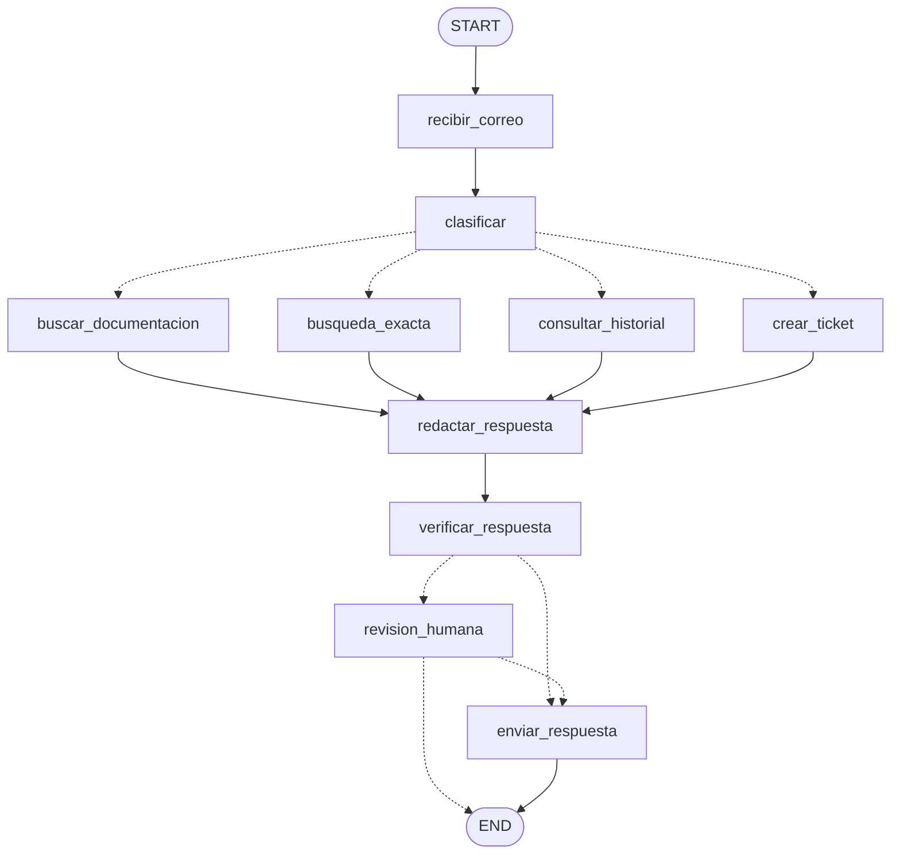

# Agente de soporte por correo (LangGraph + LangSmith)

> Corre todo en tu computador con un solo comando: `python -m soporte.api` abre el dashboard en
> http://localhost:8000. Solo necesitas una llave de OpenAI (y una de LangSmith para ver las trazas).

Atiende los correos de clientes de **Andina Automatización**, un distribuidor ficticio de componentes de
automatización industrial (sensores, válvulas neumáticas, fuentes de poder), con un catálogo de números de pieza:

1. **Clasifica** el correo (intención y urgencia) con salida estructurada.
2. **Junta contexto en paralelo:**
   - **búsqueda vectorial** (RAG) en el catálogo;
   - **búsqueda exacta**: cada número de pieza del correo se busca literalmente en el catálogo (como `grep`);
   - consulta el historial del cliente;
   - abre un caso si es una garantía o la línea del cliente está parada.
3. **Redacta** una respuesta usando solo lo que encontraron las dos búsquedas.
4. **Verifica sin LLM** que cada número de pieza y cada dato del borrador (precios, medidas, plazos)
   exista literalmente en el catálogo.
5. **Decide con código** si una persona debe revisarla: por la verificación o por reglas de negocio. Si sí,
   **se pausa** con `interrupt()` y espera a que alguien apruebe, edite o rechace, viendo el motivo.
6. **Envía** la respuesta (simulado).

Todo queda trazado en LangSmith, y hay evals con evaluadores de código y un LLM como juez.

## La idea: no confiar en la similitud para lo que tiene que ser exacto

Un RAG vectorial encuentra textos *parecidos*. Para un catálogo eso es un riesgo: `SI-M12-04P` y
`SI-M12-06P` se parecen mucho como vectores, pero la segunda pieza no existe. Un modelo que recibe la ficha
de la primera puede contestar sobre la segunda con total seguridad.

Por eso hay dos pasos determinísticos (`src/soporte/verificacion.py`), en la línea de "grep is all you need":

| Paso | Cuándo | Qué hace | Qué detecta |
|---|---|---|---|
| Búsqueda exacta | En paralelo con la vectorial | Busca literalmente los números de pieza del correo | Piezas que el cliente nombra y no existen; fichas que la búsqueda vectorial no trajo |
| Verificación final | Después de redactar, antes de enviar | Extrae números de pieza y datos con unidad del borrador y los busca en el catálogo | Referencias, precios o medidas que el modelo inventó |

Cada dato del borrador queda en uno de tres estados:

- **respaldado:** está en lo que el modelo vio;
- **fuera de contexto:** existe en el catálogo, pero el modelo no lo vio (se informa, no se bloquea);
- **no encontrado:** no aparece en ninguna parte del catálogo. Bloquea el envío y lo manda a revisión humana con el motivo.

La comparación es literal pero cuidadosa: `SI-M12-04P` no coincide dentro de `SI-M12-04P-L`, `8 bar` no coincide
dentro de `18 bar`, y `$54`, `54 USD` y `USD 54` cuentan como el mismo precio. Sus límites, a propósito: no
entiende sinónimos ni paráfrasis (solo comprueba lo que se puede comprobar literalmente) y no valida cálculos;
por eso el prompt pide no calcular totales.

## El grafo



Las líneas punteadas son rutas condicionales.

| Concepto | Dónde está |
|---|---|
| Estado compartido y reductor (`operator.add`) | `src/soporte/state.py`, clave `pasos` |
| Salida estructurada (Pydantic) | `llm.py`, `clasificar_con_llm` |
| RAG: fragmentar, hacer embeddings y buscar | `kb.py` |
| Búsqueda exacta y verificación determinística | `verificacion.py`, nodos `busqueda_exacta` y `verificar_respuesta` |
| Arista condicional con varias ramas en paralelo | `nodes.rutas_tras_clasificar` + `graph.py` |
| `Command` (actualizar estado y enrutar a la vez) | `nodes.verificar_respuesta`, `nodes.revision_humana` |
| Human in the loop con `interrupt()` | `nodes.revision_humana` |
| Checkpointer (SQLite) y `thread_id` | `api/persistencia.py`, `tests/test_api.py` |
| Errores guardados en el estado, sin tumbar el grafo | `nodes.buscar_documentacion` |
| Evals: código + LLM juez estrecho y binario | `evals/run_evals.py` |

## Instalación

```bash
python -m venv .venv
source .venv/bin/activate          # En Windows: .venv\Scripts\activate
pip install -e ".[dev]"
cp .env.example .env               # llena OPENAI_API_KEY y LANGSMITH_API_KEY
```

## Cómo usarlo

```bash
python -m soporte.api              # dashboard en http://localhost:8000 y API en /docs (abre el navegador)
pytest                             # tests del backend, sin llaves y sin gastar tokens (LLM falso)
node --test tests/js/logica.test.mjs   # opcional, si tienes Node: tests de la lógica del dashboard
python scripts/demo.py             # procesa los 8 correos de ejemplo y te pide aprobar en consola
python scripts/demo.py 4           # solo el correo #4 (línea parada, pide revisión)
langgraph dev --allow-blocking     # abre LangGraph Studio con el grafo
python evals/run_evals.py          # crea el dataset en LangSmith y corre el experimento
```

### En LangGraph Studio

1. Corre `langgraph dev --allow-blocking` y abre el enlace de Studio que aparece en la terminal.
   (`--allow-blocking` evita que el servidor de desarrollo bloquee el tracer de LangSmith, que hace
   llamadas síncronas al iniciar; sin él, las corridas de Studio no aparecen en LangSmith.)
2. En *Input* llena `remitente`, `asunto` y `cuerpo` (el grafo declara ese esquema de entrada), por ejemplo:
   ```json
   {"remitente": "mantenimiento@textilesandes.com", "asunto": "Línea parada", "cuerpo": "El sensor SI-M12-04P dejó de detectar y tenemos la línea parada."}
   ```
3. Mira cómo corren en paralelo las ramas de contexto y cómo el grafo se detiene en `revision_humana`.
4. Reanuda con `{"accion": "aprobar"}`, `{"accion": "editar", "texto": "..."}` o `{"accion": "rechazar"}`.
5. Abre la traza en LangSmith para ver el prompt, los fragmentos recuperados y los tokens de cada paso.

## El dashboard y la API

`python -m soporte.api` levanta un solo servidor (FastAPI) que sirve dos cosas:

- **El dashboard** en `/`: HTML, CSS y JavaScript sin compilar (`src/soporte/web/`). Bandeja de casos de prueba,
  detalle con la revisión humana y un panel de tránsito con cada nodo del grafo en vivo.
- **La API** en `/api`, que transmite cada paso del grafo como Server-Sent Events:

| Método | Ruta | Qué hace |
|---|---|---|
| GET | `/api/salud` | Estado del servidor y dónde guarda los checkpoints (sqlite o memoria) |
| GET | `/api/casos` | Los correos de prueba con su resultado esperado |
| POST | `/api/corridas` | Procesa un correo y transmite eventos: `inicio`, `nodo_inicio`, `nodo_fin`, `pausa`, `fin`, `error` |
| POST | `/api/corridas/{id}/decision` | Reanuda una corrida pausada con `aprobar`, `editar` o `rechazar` |
| GET | `/api/corridas/{id}` | Estado actual de una corrida |

Los checkpoints del grafo se guardan en `data/checkpoints.sqlite`: si cierras el servidor con una corrida
esperando revisión, al volver a abrirlo (y recargar la página) puedes aprobarla. Con `CHECKPOINTS=memoria`
en `.env` se guardan en memoria.

Cómo falla de forma controlada:

- **Entradas inválidas:** 422 con el campo y el mensaje (`{"error": ..., "detalles": [...]}`).
- **Errores a mitad del grafo:** llegan como evento `error` con un mensaje para el usuario; el detalle técnico solo va al log.
- **Corrida inexistente o que no espera decisión:** 404 o 409.
- **Servidor apagado:** el dashboard lo indica y ofrece reintentar.
- **Llamadas al modelo:** con timeout y reintentos.

## Costo

Por defecto se usa `gpt-4.1-mini` y `text-embedding-3-small`; los dos se cambian en `.env`. Con los precios publicados por OpenAI (revísalos antes de usar), un correo cuesta del orden de **un décimo de centavo de dólar**: dos llamadas al LLM de menos de 2.000 tokens. Una corrida completa de evals (8 correos más el juez) cuesta unos **2 centavos**. Configura un límite de gasto en el panel de OpenAI.

## Decisiones de diseño

- **Workflow, no agente libre.** El camino se conoce de antemano, así que un grafo explícito es más predecible y fácil de probar que un loop ReAct que decide solo.
- **El LLM clasifica y redacta; el código decide.** Quién revisa lo deciden `motivos_de_negocio` y la verificación, no el prompt.
- **Lo exacto se comprueba con búsqueda exacta.** Los embeddings sirven para encontrar; para confirmar un número de pieza o un precio se usa comparación literal.
- **`interrupt()` al inicio del nodo.** Al reanudar, el nodo se ejecuta otra vez desde el principio; nada costoso o con efectos va antes de la pausa.
- **Estado con tipos simples.** La clasificación se guarda como dict para que serialice bien en el checkpointer y se lea fácil en Studio.
- **LLM aislado en `llm.py`.** Los tests lo reemplazan con `monkeypatch`, así que corren sin red y sin costo.
- **Un fragmento por sección del markdown.** Cada sección responde una sola pregunta, y la fuente (`archivo#sección`) se puede citar.

## Cómo se construyó

En cuatro PRs apilados; cada uno parte del anterior y deja los tests en verde:

1. `pr/01-flujo-basico`: flujo lineal y salida estructurada.
2. `pr/02-rag-y-contexto`: RAG, historial y tickets en paralelo.
3. `pr/03-revision-humana`: `interrupt()` y `Command`.
4. `pr/04-evals-y-demo`: evals en LangSmith, la demo y esta documentación.
5. `pr/05-ajustes-studio-y-tests`: correcciones tras probarlo en Windows (numpy faltante,
   esquema de entrada para Studio, prompt que usa los datos concretos de la documentación).
6. `pr/06-api`: API FastAPI con streaming, checkpointer Postgres y límites de uso.
7. `pr/07-dashboard`: dashboard en Next.js con panel de tránsito en vivo y casos de prueba.
8. `pr/08-ejecucion-local`: todo local con un comando: SQLite en vez de Postgres y dashboard sin compilar
   servido por la misma API (sin Neon, Render, Vercel ni Node).
9. `pr/09-catalogo-industrial`: los datos pasan a un distribuidor de piezas industriales con números de pieza,
   equivalencias y reglas de configuración; incluye dos casos trampa (una pieza y una combinación que no existen).
10. `pr/10-verificacion-exacta`: búsqueda exacta de números de pieza en paralelo con la vectorial y verificación
    determinística del borrador antes de enviarlo; el dashboard muestra de dónde salió cada fuente y qué se verificó.

## Siguientes pasos

- Reintento de la búsqueda cuando falla, con una arista de vuelta a `buscar_documentacion`.
- Evals online y automatizaciones en LangSmith sobre tráfico real.
